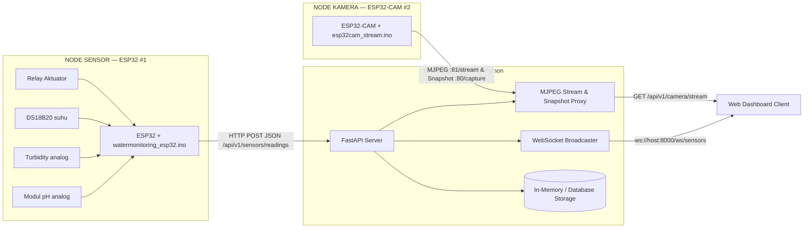

# Dokumentasi Sistem Water Monitoring + ESP32-CAM

Dokumentasi teknis untuk dua firmware dalam proyek ini:

| Firmware | Folder | Fungsi |
|---|---|---|
| Water Monitoring | [`watermonitoring_esp32/`](../watermonitoring_esp32/watermonitoring_esp32.ino) | Baca pH, kekeruhan (turbidity), suhu (DS18B20), kontrol relay, kalibrasi 2 titik disimpan di NVS |
| Stream Kamera | [`esp32cam_stream/`](../esp32cam_stream/esp32cam_stream.ino) | Stream MJPEG via IP + portal konfigurasi WiFi (WiFiManager) |

> **Target yang didokumentasikan di sini:** cara pakai firmware, penjelasan tiap bagian kode, cara implementasi kalibrasi, serta cara mengintegrasikan keduanya ke backend dan web dashboard untuk **client** kamu.

---

## Daftar Isi

1. [Arsitektur Sistem](#1-arsitektur-sistem)
2. [Persiapan Hardware & Wiring](#2-persiapan-hardware--wiring)
3. [Library yang Dibutuhkan](#3-library-yang-dibutuhkan)
4. [Cara Pakai: Water Monitoring](#4-cara-pakai-water-monitoring)
5. [Cara Pakai: ESP32-CAM](#5-cara-pakai-esp32-cam)
6. [Penjelasan Kode: Water Monitoring](#6-penjelasan-kode-water-monitoring)
7. [Penjelasan Kode: ESP32-CAM](#7-penjelasan-kode-esp32-cam)
8. [Kalibrasi: Konsep & Implementasi](#8-kalibrasi-konsep--implementasi)
9. [Integrasi Backend & Client](#9-integrasi-backend--client)
10. [Modifikasi Firmware untuk Kirim Data](#10-modifikasi-firmware-untuk-kirim-data)
11. [Troubleshooting](#11-troubleshooting)

---

## 1. Arsitektur Sistem



Dua node hardware terpisah (sensor & kamera):
1. **Node Sensor (ESP32):** Mengukur pH, kekeruhan, suhu, dan kontrol relay. Mengirimkan data terkalibrasi via HTTP POST JSON ke endpoint FastAPI `/api/v1/sensors/readings`.
2. **Node Kamera (ESP32-CAM):** Melayani stream video MJPEG pada port 81 dan endpoint snapshot JPEG pada port 80.
3. **Backend FastAPI:** Berperan sebagai pusat agregasi, proxy streaming video (meniadakan isu CORS), penilai otomatis mutu kualitas air, dan penyedia WebSocket untuk dashboard realtime.

---

## 2. Persiapan Hardware & Wiring

### 2.1 Node Sensor (ESP32)


*Gambar 2.1: Skema wiring diagram breadboard untuk Node Sensor ESP32 (Sensor pH, Turbidity, DS18B20, dan Modul Relay).*

| Sensor | Pin ESP32 | Catatan |
|---|---|---|
| Modul pH (output analog) | **GPIO 34** | ADC1, toleran input 0–3.3 V |
| Modul Turbidity (output analog) | **GPIO 35** | ADC1 |
| DS18B20 (data) | **GPIO 4** | pakai resistor **4.7 kΩ pull-up** ke 3.3 V |
| Relay (IN) | **GPIO 27** | aktif-LOW pada modul relay umum (`RELAY_PIN 27` pada firmware)* |
| GND sensors | GND | semua referensi ground disamakan |

> *Catatan Pin Relay:* Pada kode firmware [`watermonitoring_esp32.ino`](../watermonitoring_esp32/watermonitoring_esp32.ino), pin relay didefinisikan pada `#define RELAY_PIN 27`. Jika perakitan fisik/breadboard menggunakan pin lain (misalnya GPIO 12), pastikan definisi `#define RELAY_PIN` pada firmware disesuaikan agar sama persis dengan koneksi fisiknya.
>
> Pin 34 & 35 adalah **ADC input-only** — aman dipakai baca analog. Hindari pin ADC yang sekaligus dipakai WiFi.

### 2.2 Kamera (AI Thinker ESP32-CAM)

Pin sudah dikodekan di firmware (konfigurasi `camera_config_t`). Untuk board **AI Thinker ESP32-CAM**, pakai pin bawaan berikut (sudah di-match di kode, tidak perlu diubah):

```
PWDN=32  RESET=-1  XCLK=0
SIOD=26  SIOC=27
D7=35  D6=34  D5=39  D4=36
D3=21  D2=19  D1=18  D0=5
VSYNC=25  HREF=23  PCLK=22
```

> Jika board kamu bukan AI Thinker (mis. Freenove/Freenove clone, M5Stack), **pin camera ini, bukan definisi pin layar/board lain, yang harus disesuaikan**.

---

## 3. Library yang Dibutuhkan

### 3.1 `watermonitoring_esp32.ino`

Install lewat **Library Manager** (Sketch → Include Library → Manage Libraries):

| Library | Versi (u/ replikasi) | Fungsi |
|---|---|---|
| `OneWire` by Paul Stoffregen | `2.3.x` | Protokol 1-Wire DS18B20 |
| `DallasTemperature` by Miles Burton | `3.9.x` | Abstraksi DS18B20 (derajat C) |
| `Preferences` | bawaan ESP32 core | Simpan kalibrasi di NVS |

### 3.2 `esp32cam_stream.ino`

| Library | Fungsi |
|---|---|
| `WiFiManager` by tzapu | Portal konfigurasi WiFi (AP + captive portal) |
| `WebServer` | Endpoint HTTP (`/` dan `/stream`) |
| `esp_camera` | Bawaan ESP32 core (driver kamera) |
| `img_converters` | Bawaan (helpers konversi frame) |

### 3.3 Board & Partitions

- **Board:** `AI Thinker ESP32-CAM` (atau `ESP32 Dev Module` untuk node sensor).
- **Partition scheme:** untuk ESP32-CAM pakai skema dengan **PSRAM**, mis. `Huge APP (3MB No OTA/1MB SPIFFS)` atau `Minimal SPIFFS` — pastikan PSRAM terdeteksi.
- **Upload speed:** `115200`.
- Upload ESP32-CAM butuh **FTDI adapter** (USB-UART). Skema koneksi FTDI→board:

```
FTDI 5V  → 5V (kalau regulasi eksternal) ATAU FTDI 3.3V → 3.3V
FTDI TX  → U0R (GPIO 3)
FTDI RX  → U0T (GPIO 1)
FTDI GND → GND
GPIO0 → GND (masuk flash mode saat upload)
```

---

## 4. Cara Pakai: Water Monitoring

1. Pasang wiring sesuai §2.1.
2. Install library §3.1, pilih board `ESP32 Dev Module`, `Analog Resolution 12-bit`.
3. Flash firmware, buka **Serial Monitor** baud `115200`.
4. Akan muncul menu:

```
===== MENU =====
1. Baca semua sensor berulang (ketik stop untuk berhenti)
2. Kalibrasi PH (2 titik dinamis)
3. Kalibrasi Turbidity (2 titik)
4. Reset kalibrasi
5. Test relay (ON/OFF bergantian 3x)
6. Kalibrasi offset PH (short probe ke GND)
Pilih nomor + Enter:
```
5. Ketik nomor + `Enter` untuk menjalankan.
6. Pilih opsi `1` untuk membaca suhu, pH, dan turbidity berulang setiap 2 detik.
7. Saat mode tersebut aktif, ketik `stop` lalu `Enter` untuk menghentikan pembacaan dan kembali ke menu.

> Sebelum baca, **kalibrasi dulu** (opsi 2/3/6) supaya nilai pH/turbidity bermakna numerik, bukan tegangan mentah. Untuk pH, angka referensi dimasukkan dari pembacaan pH meter konvensional.

---

## 5. Cara Pakai: ESP32-CAM

1. Flash firmware (pastikan PSRAM aktif, partition scheme pakai yang mendukung PSRAM, misal *Huge APP*).
2. **Pertama kali dihidupkan** (belum punya kredensial WiFi):
   - Board otomatis membuat Access Point **`ESP32CAM-Setup`**, password **`12345678`**.
   - Hubungkan HP/laptop ke AP tersebut, buka browser ke **`http://192.168.4.1`**.
   - Pilih jaringan WiFi (SSID), isi password, lalu simpan.
3. Setelah terhubung ke WiFi, Serial Monitor akan mencetak IP lokal board. Endpoint yang tersedia:
   - **`http://IP/`** → Web UI interaktif (preview stream, tombol snapshot, tombol kontrol flash LED, dan info endpoint).
   - **`http://IP:81/stream`** → Stream MJPEG bersih (untuk proxy backend FastAPI, OpenCV, atau browser langsung).
   - **`http://IP/capture`** → Mengambil 1 frame gambar JPEG still snapshot (digunakan oleh FastAPI untuk snapshot on-demand atau analisis AI).
   - **`http://IP/status`** → Telemetri kesehatan perangkat dalam format JSON (RSSI, IP, PSRAM, Free Heap, Flash LED).
   - **`http://IP/flash?state=1`** (atau `0`) → Menyalakan / mematikan lampu Flash LED bawaan (GPIO 4).
   - **`http://IP/reset`** → Menghapus konfigurasi WiFi dan restart board.
4. Untuk mengganti WiFi di kemudian hari: buka `http://IP/reset` atau klik tombol *Reset WiFi* di web UI.

---

## 6. Penjelasan Kode: Water Monitoring

### 6.1 Include & Definisi Pin

```cpp
#include <OneWire.h>
#include <DallasTemperature.h>
#include <Preferences.h>

#define PH_PIN    34
#define TURB_PIN  35
#define TEMP_PIN  4
#define RELAY_PIN 27
#define ADC_VREF  3.3f
#define ADC_MAX   4095.0f
```

- `OneWire` + `DallasTemperature` = stack DS18B20.
- `Preferences` = NVS flash, nilai kalibrasi tetap ada setelah reboot/blackout.
- `ADC_VREF`/`ADC_MAX` = konversi ADC ke volt. Resolusi ADC di-set 12-bit di `setup()`, jadi rentang `0..4095` → `0..3.3V`.

### 6.2 Struct Kalibrasi (model linier)

```cpp
// y = slope * volt + offset (kalibrasi 2 titik)
struct Cal { float slope, offset; bool valid; };
Cal calPH = {1.0, 0.0, false}, calTurb = {1.0, 0.0, false};
```

Seluruh sistem kalibrasi memakai model garis lurus:

```
nilai_fisik = slope × voltase + offset
```

`valid=false` artinya belum dikalibrasi → program mencetak voltase mentah, bukan nilai tebakan. Ini mencegah angka pH/turbidity bohongan.

### 6.3 Pembacaan Tegangan & Averaging

```cpp
float readVolt(int pin) { return analogRead(pin) * ADC_VREF / ADC_MAX; }

float applyCal(Cal c, float volt) { return c.slope * volt + c.offset; }

float avgVolt(int pin) {  // 64 sampel untuk buang noise
  float s = 0;
  for (int i = 0; i < 64; i++) { s += readVolt(pin); delay(5); }
  return s / 64.0f;
}
```

- `readVolt` = konversi mentah ADC → volt.
- `applyCal` = terapkan model linier.
- `avgVolt` = **64 sampel** (≈320 ms) untuk meredam noise. Nilai analog pH/turbidity fluktuatif; rata-rata mengurangi jitter tampilan.

### 6.4 Helper Input Serial

```cpp
bool waitYes() {
  while (!Serial.available()) delay(10);
  String s = Serial.readStringUntil('\n'); s.trim();
  return s.equalsIgnoreCase("y");
}

float readFloat(const char *prompt) {
  while (true) {
    Serial.println(prompt);
    while (!Serial.available()) delay(10);
    String s = Serial.readStringUntil('\n'); s.trim();
    if (s.length() > 0) {
      float v = s.toFloat();
      if (v != 0 || s.indexOf('0') >= 0) return v;
    }
    Serial.println("Input salah, ulangi.");
  }
}
```

- `waitYes` = blocking tunggu tombol `y`.
- `readFloat` = validasi input numerik (menerima `0` sebagai angka valid lewat trik `s.indexOf('0') >= 0`).

### 6.5 Simpan & Muat Kalibrasi (NVS)

```cpp
void saveCal(const char *key, Cal &c) {
  prefs.begin("cal", false);
  prefs.putFloat((String(key) + "m").c_str(), c.slope);   // m = slope
  prefs.putFloat((String(key) + "b").c_str(), c.offset);  // b = offset
  prefs.putBool ((String(key) + "ok").c_str(), true);     // ok = valid
  prefs.end();
}

void loadCal() {
  prefs.begin("cal", true);
  if (prefs.getBool("phok", false)) {
    calPH.slope  = prefs.getFloat("phm", 1.0);
    calPH.offset = prefs.getFloat("phb", 0.0);
    calPH.valid  = true;
  }
  if (prefs.getBool("tbok", false)) { /* ...sama untuk turbidity... */ }
  prefs.end();
}
```

Skema key di namespace `cal`:

| Sensor | slope | offset | valid |
|---|---|---|---|
| pH | `phm` | `phb` | `phok` |
| Turbidity | `tbm` | `tbb` | `tbok` |

`begin("cal", false)` = mode baca-tulis; `begin("cal", true)` = mode read-only.

### 6.6 Kalibrasi 2 Titik (`calibrate`)

```cpp
void calibrate(const char *name, const char *key, int pin, Cal &c) {
  float v1, y1, v2, y2;
  // TITIK 1 (referensi rendah)
  v1 = avgVolt(pin);
  y1 = readFloat("Masukkan nilai referensi titik-1:");

  // TITIK 2 (referensi tinggi)
  v2 = avgVolt(pin);
  y2 = readFloat("Masukkan nilai referensi titik-2:");

  if (fabsf(v2 - v1) < 0.001f) { /* guard pembagi nol */ return; }

  c.slope  = (y2 - y1) / (v2 - v1);
  c.offset = y1 - c.slope * v1;
  c.valid  = true;
  saveCal(key, c);
}
```

Matematika (detail di §8):

```
slope  = (y2 − y1) / (v2 − v1)
offset = y1 − slope × v1
```

Guard `fabsf(v2 - v1) < 0.001f` mencegah **pembagian nol** bila kedua larutan menghasilkan tegangan hampir sama (mis. probe tidak tercelup).

### 6.6a Kalibrasi pH Dinamis (`calibratePH`)

Kalibrasi pH memakai dua larutan yang tersedia, misalnya buffer pH 7 dan pH 9. Kode tidak mengunci angka referensi tersebut. Setelah masing-masing tegangan diukur, masukkan hasil aktual yang terlihat pada pH meter konvensional (contoh `7.02` dan `8.96`). Nilai harus berada pada rentang 0–14 dan disimpan bersama slope/offset ke NVS.

### 6.7 Kalibrasi Offset pH (short probe)

```cpp
void calShortPH() {
  // short pin tengah BNC prob ke GND board
  // Serial menampilkan tegangan realtime; ketik y saat stabil
  float v = captureShortVoltage();
  if (v < 1.0f || v > 4.0f) { /* warning */ }
  float targetPH = readPHReference("Masukkan pH target untuk kondisi short:");
  calPH.offset = targetPH - calPH.slope * v;
  calPH.valid = true;
  saveCal("ph", calPH);
}
```

Ini kalibrasi **1 titik (offset saja)** — slope dipertahankan dari kalibrasi 2 titik. Saat opsi 6 berjalan, ESP32 menampilkan tegangan `PH_PIN` secara realtime setiap 500 ms. Tidak perlu multimeter; ketik `y` saat tegangan stabil, lalu masukkan target pH untuk kondisi short (biasanya 7.00 jika mengikuti titik netral modul). Opsi ini tidak menggantikan kalibrasi dua buffer pH.

### 6.8 `setup()` & `loop()`

```cpp
void setup() {
  Serial.begin(115200);
  analogReadResolution(12);       // 0..4095
  analogSetAttenuation(ADC_11db); // rentang penuh ~3.3V
  pinMode(RELAY_PIN, OUTPUT);
  setRelay(false);                // relay aktif-LOW: false = MATI (tulis HIGH) saat boot
  ds18b20.begin();
  loadCal();
  Serial.println("\nWater Monitoring ESP32 siap.");
}
```

- `analogSetAttenuation(ADC_11db)` mengaktifkan atenuasi penuh supaya bisa baca hingga ~3.3 V (default 11 dB tak semua pin).
- `setRelay(false)` mematikan relay saat boot dengan menulis logic `HIGH` (karena modul relay aktif-LOW), mencegah pompa/valve menyala mendadak saat booting.
- `loop()` = menu loop sederhana: cetak menu → tunggu input → `switch` atas karakter pertama → jalankan aksi → kembali cetak menu.

---

## 7. Penjelasan Kode: ESP32-CAM

### 7.1 Pin & Objek

```cpp
#include "esp_camera.h"
#include <WiFiManager.h>
#include <WebServer.h>
#include "img_converters.h"

#define FLASH_LED_PIN 4

WebServer portal(80);    // Port 80: REST API (/capture, /status, /flash) + UI
WebServer streamer(81);  // Port 81: MJPEG Stream murni
camera_fb_t *fb = NULL;
```

Dua instance `WebServer` dipisahkan:
- **Port 81 (`streamer`):** Didedikasikan khusus untuk loop streaming MJPEG kontinu.
- **Port 80 (`portal`):** Menangani panggilan REST API dari FastAPI (`/capture`, `/status`, `/flash`), serta UI web. Dengan pemisahan port ini, panggilan snapshot JPEG on-demand tidak terhalang atau ter-block oleh klien yang sedang menonton live stream video.
- **`FLASH_LED_PIN` (GPIO 4):** Mengontrol transistor daya untuk lampu LED flash berdaya tinggi pada AI Thinker ESP32-CAM. Berguna untuk penerangan tangki air gelap atau pemantauan malam hari.

### 7.2 Konfigurasi Kamera (`camInit`)

```cpp
bool camInit() {
  camera_config_t cfg = {};
  // ... inisialisasi pin AI Thinker ...
  cfg.xclk_freq_hz = 20000000;      // 20 MHz clock sensor OV2640
  cfg.pixel_format = PIXFORMAT_JPEG; // Output langsung format JPEG terkompresi
  cfg.frame_size   = FRAMESIZE_QVGA; // 320x240 (fallback DRAM)
  cfg.jpeg_quality = 12;             // 0..63 (makin kecil makin tinggi kualitasnya)
  cfg.fb_count     = 1;
  cfg.fb_location  = CAMERA_FB_IN_DRAM;

  // Jika PSRAM terdeteksi, naikkan resolusi dan gunakan buffer ganda (smooth streaming)
  if (psramFound()) {
    cfg.frame_size  = FRAMESIZE_SVGA; // 800x600 (ideal untuk stream & AI/OpenCV)
    cfg.jpeg_quality = 10;
    cfg.fb_count    = 2;
    cfg.fb_location = CAMERA_FB_IN_PSRAM;
  }
  return esp_camera_init(&cfg) == ESP_OK;
}
```

- `PIXFORMAT_JPEG`: Sensor OV2640 mengompresi langsung ke JPEG via chip hardware internal, menghemat CPU ESP32.
- `psramFound()`: Jika external PSRAM 4MB aktif pada board, alokasi frame buffer dipindahkan ke PSRAM dengan resolusi `SVGA (800x600)` dan `fb_count = 2` (double-buffering), sehingga stream berjalan mulus tanpa frame tearing.

### 7.3 Handler Endpoint REST & Streaming

#### A. Stream MJPEG (`handleStream` — Port 81)
```cpp
void handleStream() {
  WiFiClient client = streamer.client();
  client.print("HTTP/1.1 200 OK\r\n"
               "Access-Control-Allow-Origin: *\r\n"
               "Content-Type: multipart/x-mixed-replace;boundary=frame\r\n"
               "Cache-Control: no-cache, private\r\n"
               "Pragma: no-cache\r\n\r\n");

  while (client.connected()) {
    fb = esp_camera_fb_get();
    if (!fb) { delay(10); continue; }
    client.print("--frame\r\nContent-Type: image/jpeg\r\nContent-Length: " + String(fb->len) + "\r\n\r\n");
    client.write(fb->buf, fb->len);
    client.print("\r\n");
    esp_camera_fb_return(fb);
    fb = NULL;
    vTaskDelay(pdMS_TO_TICKS(1)); // Yield ke scheduler FreeRTOS agar WDT tidak terpicu
  }
}
```
- Header `Access-Control-Allow-Origin: *` mengizinkan pemanggilan langsung tanpa terhalang kebijakan CORS.
- Header `multipart/x-mixed-replace;boundary=frame` mengirimkan stream gambar secara beruntun.
- `esp_camera_fb_return(fb)` **wajib dipanggil** di setiap iterasi untuk mengembalikan buffer memori ke driver DMA. Jika terlewat, memori akan bocor (*heap exhaustion*) dan board hang/crash dalam hitungan detik.

#### B. Snapshot JPEG Tunggal (`handleCapture` — Port 80)
```cpp
void handleCapture() {
  camera_fb_t *frame = esp_camera_fb_get();
  if (!frame) {
    portal.sendHeader("Access-Control-Allow-Origin", "*");
    portal.send(503, "application/json", "{\"error\":\"Kamera gagal mengambil frame\"}");
    return;
  }
  portal.sendHeader("Access-Control-Allow-Origin", "*");
  portal.sendHeader("Content-Disposition", "inline; filename=capture.jpg");
  portal.sendHeader("Cache-Control", "no-cache, no-store, must-revalidate");
  portal.setContentLength(frame->len);
  portal.send(200, "image/jpeg", "");

  WiFiClient client = portal.client();
  if (client.connected()) client.write(frame->buf, frame->len);
  esp_camera_fb_return(frame);
}
```
- Menyajikan 1 frame gambar JPEG murni dengan `Content-Type: image/jpeg`.
- Ini endpoint utama yang dikonsumsi oleh backend **FastAPI** (`GET /api/v1/camera/snapshot`) untuk keperluan image processing atau penyimpanan berkala.

#### C. Telemetri Status Perangkat (`handleStatus` — Port 80)
Mengembalikan JSON berisi informasi jaringan, RSSI sinyal WiFi, ketersediaan PSRAM, sisa heap memory, dan status flash LED.

#### D. Kontrol Flash LED (`handleFlash` — Port 80)
Menerima query parameter `?state=1` (menyalakan LED) atau `?state=0` (mematikan LED) atau `?toggle=1`.

### 7.4 `setup()` — WiFiManager & Registrasi Route

```cpp
void setup() {
  // Inisialisasi Flash LED
  pinMode(FLASH_LED_PIN, OUTPUT);
  digitalWrite(FLASH_LED_PIN, LOW);

  camInit();

  WiFi.mode(WIFI_STA);
  WiFiManager wm;
  wm.setConfigPortalTimeout(180);
  if (WiFi.SSID() == "" || WiFi.waitForConnectResult() != WL_CONNECTED) {
    wm.autoConnect("ESP32CAM-Setup", "12345678");
  }

  // Daftarkan route Port 80
  portal.on("/", HTTP_GET, handleRoot);
  portal.on("/capture", HTTP_GET, handleCapture);
  portal.on("/status", HTTP_GET, handleStatus);
  portal.on("/flash", HTTP_GET, handleFlash);
  portal.on("/reset", HTTP_GET, handleReset);
  portal.begin();

  // Daftarkan route Port 81
  streamer.on("/stream", HTTP_GET, handleStream);
  streamer.begin();
}
```

---

## 8. Kalibrasi: Konsep, Rumus Matematika, & Penerapan di Kode Implementasi

Pada sistem pemantauan kualitas air, akurasi sensor analog (pH dan Turbidity) sangat bergantung pada kalibrasi yang tepat. Bagian ini menjelaskan secara matematis dan teknis bagaimana nilai kalibrasi dihitung, disimpan ke memori non-volatile (NVS), dan bagaimana nilai tersebut dieksekusi di dalam kode firmware saat pembacaan runtime.

### 8.1 Model Matematika Linier ($y = mx + b$)

Sensor probe pH dan sensor kekeruhan (turbidity phototransistor) menghasilkan sinyal tegangan listrik analog ($V$) pada rentang $0.0\text{ V} - 3.3\text{ V}$. Dalam rentang kerja normal, hubungan antara tegangan keluaran ($V$) dengan nilai fisik ($y$, berupa derajat pH atau satuan NTU) dimodelkan sebagai persamaan garis linier:

$$
y = m \cdot V + b
$$

Di mana:
- $y$ = Nilai fisik terukur ($\text{pH}$ atau $\text{NTU}$).
- $V$ = Tegangan analog terukur dari sensor (Volt).
- $m$ = *Slope* (kemiringan garis respon sensor).
- $b$ = *Offset* / *intercept* (titik potong sumbu saat $V = 0$).

#### Karakteristik Khusus Probe Sensor:
1. **Sensor pH Analog:** Memiliki kemiringan negatif ($m < 0$). Semakin tinggi konsentrasi ion hidrogen (larutan semakin asam, pH rendah), tegangan output elektroda semakin tinggi. Sebaliknya, pada larutan basa (pH tinggi), tegangan output elektroda probe semakin turun.
2. **Sensor Turbidity (Kekeruhan):** Menggunakan phototransistor inframerah. Pada air bening (0 NTU), cahaya menembus air maksimal sehingga tegangan output tinggi ($\approx 2.5\text{ V} - 3.0\text{ V}$). Semakin keruh air (banyak partikel tersuspensi), cahaya terhalang sehingga tegangan analog turun ($m < 0$).

### 8.2 Menghitung Nilai Kalibrasi Dua Titik (Two-Point Dynamic Calibration)

Untuk membentuk persamaan garis linier yang akurat, dibutuhkan dua titik kalibrasi independen: $(V_1, y_1)$ dan $(V_2, y_2)$:
- **Titik 1:** Mengukur larutan buffer/standar pertama dengan nilai fisik $y_1$, terbaca tegangan rata-rata $V_1$.
- **Titik 2:** Mengukur larutan buffer/standar kedua dengan nilai fisik $y_2$, terbaca tegangan rata-rata $V_2$.

Rumus perhitungan kemiringan (*slope* $m$):

$$
m = \frac{y_2 - y_1}{V_2 - V_1}
$$

Rumus perhitungan pergeseran (*offset* $b$):

$$
b = y_1 - (m \cdot V_1)
$$

### 8.3 Struktur Data Kalibrasi pada Firmware (`Cal`)

Di dalam firmware [watermonitoring_esp32.ino](../watermonitoring_esp32/watermonitoring_esp32.ino), parameter kalibrasi dibungkus dalam sebuah `struct`:

```cpp
// y = slope * volt + offset (kalibrasi 2 titik)
struct Cal { float slope, offset; bool valid; };
Cal calPH = {1.0, 0.0, false}, calTurb = {1.0, 0.0, false};
```

### 8.4 Reduksi Derau ADC (Oversampling & Filtering)

ESP32 menggunakan ADC 12-bit (resolusi 0–4095) yang rentan terhadap *noise* elektromagnetik frekuensi tinggi. Sebelum nilai tegangan dihitung ke dalam rumus kalibrasi, firmware menjalankan fungsi `avgVolt()` untuk mengambil rata-rata 64 kali pembacaan berturut-turut dengan interval delay 5 ms:

```cpp
float readVolt(int pin) { return analogRead(pin) * ADC_VREF / ADC_MAX; }

float applyCal(Cal c, float volt) { return c.slope * volt + c.offset; }

float avgVolt(int pin) {  // 64 sampel untuk buang noise
  float s = 0;
  for (int i = 0; i < 64; i++) { s += readVolt(pin); delay(5); }
  return s / 64.0f;
}
```

### 8.5 Penyimpanan Permanen ke NVS (Non-Volatile Storage)

Setelah pengguna menyelesaikan proses kalibrasi melalui Serial Monitor (opsi 2 untuk pH atau opsi 3 untuk Turbidity), fungsi generik `saveCal()` menulis nilai slope ($m$), offset ($b$), dan flag validitas ke flash NVS ESP32 menggunakan library `Preferences.h`. Data ini **tidak akan hilang** meskipun ESP32 dimatikan atau di-restart:

```cpp
#include <Preferences.h>
Preferences prefs;

void saveCal(const char *key, Cal &c) {
  prefs.begin("cal", false);                            // Buka namespace "cal" (Read-Write)
  prefs.putFloat((String(key) + "m").c_str(), c.slope);  // Key: phm / tbm
  prefs.putFloat((String(key) + "b").c_str(), c.offset); // Key: phb / tbb
  prefs.putBool ((String(key) + "ok").c_str(), true);    // Key: phok / tbok
  prefs.end();
}
```

### 8.6 Pemuatan Kalibrasi Saat Startup Booting (`loadCal`)

Saat ESP32 pertama kali dinyalakan, fungsi `setup()` mengeksekusi `loadCal()` untuk menarik nilai kalibrasi dari NVS ke memori RAM:

```cpp
void loadCal() {
  prefs.begin("cal", true); // Buka namespace "cal" dalam mode Read-Only
  if (prefs.getBool("phok", false)) {
    calPH.slope  = prefs.getFloat("phm", 1.0);
    calPH.offset = prefs.getFloat("phb", 0.0);
    calPH.valid  = true;
  }
  if (prefs.getBool("tbok", false)) {
    calTurb.slope  = prefs.getFloat("tbm", 1.0);
    calTurb.offset = prefs.getFloat("tbb", 0.0);
    calTurb.valid  = true;
  }
  prefs.end();
}
```

### 8.7 Penerapan Nilai Kalibrasi pada Kode Runtime (`applyCal`)

Inilah inti dari bagaimana hasil kalibrasi bekerja saat pembacaan sensor aktif. Fungsi konversi linier didefinisikan secara ringkas:

```cpp
float applyCal(Cal c, float volt) { return c.slope * volt + c.offset; }
```

Pada fungsi pembacaan data (`printSensorReadings()`):

```cpp
Serial.print("PH: ");
if (calPH.valid) {
  Serial.println(applyCal(calPH, avgVolt(PH_PIN)), 2);
} else {
  Serial.print("BELUM KALIBRASI, volt=");
  Serial.println(avgVolt(PH_PIN), 3);
}

Serial.print("Turbidity: ");
if (calTurb.valid) {
  Serial.println(applyCal(calTurb, avgVolt(TURB_PIN)), 1);
} else {
  Serial.print("BELUM KALIBRASI, volt=");
  Serial.println(avgVolt(TURB_PIN), 3);
}
```

Jika sensor belum pernah dikalibrasi (`cal.valid == false`), sistem tidak akan menampilkan angka rekayasa atau nilai default yang menyesatkan, melainkan mencetak pesan `BELUM KALIBRASI` beserta tegangan analog mentahnya.

### 8.8 Contoh Nyata Perhitungan & Eksekusi Angka (Studi Kasus Kalibrasi)

Berikut adalah simulasi numerik nyata dari kalibrasi probe pH:

#### Tahap 1: Kalibrasi Dua Larutan Buffer Standar
1. **Titik 1 (Buffer pH Netral 7.00):**
   - Probe dicelupkan ke larutan buffer pH 7.00 ($y_1 = 7.00$).
   - Fungsi `avgVolt(PH_PIN)` membaca tegangan stabil: $V_1 = 2.250\text{ V}$.
2. **Titik 2 (Buffer pH Basa 9.00):**
   - Probe dibilas air distilasi lalu dicelupkan ke buffer pH 9.00 ($y_2 = 9.00$).
   - Fungsi `avgVolt(PH_PIN)` membaca tegangan stabil: $V_2 = 1.950\text{ V}$.

#### Tahap 2: Firmware Menghitung Slope dan Offset
1. **Perhitungan Kemiringan (*Slope* $m$):**
   $$
   m = \frac{9.00 - 7.00}{1.950 - 2.250} = \frac{2.00}{-0.300} \approx -6.6667
   $$
2. **Perhitungan Pergeseran (*Offset* $b$):**
   $$
   b = y_1 - (m \cdot V_1) = 7.00 - (-6.6667 \times 2.250) = 7.00 - (-15.000) = 22.000
   $$
3. Nilai $m = -6.6667$ dan $b = 22.000$ disimpan ke NVS. `calPH.valid` di-set menjadi `true`.

#### Tahap 3: Penerapan Saat Mengukur Sampel Air Riil
1. Sensor dicelupkan ke dalam air kolam atau sampel akuarium.
2. `avgVolt(PH_PIN)` membaca tegangan sebesar $V = 2.100\text{ V}$.
3. Firmware memanggil `applyCal(calPH, 2.100)`:
   $$
   \text{pH} = (m \cdot V) + b = (-6.6667 \times 2.100) + 22.000 = -14.000 + 22.000 = 8.00
   $$
4. Hasil **pH = 8.00** diperoleh secara presisi dan dikemas ke dalam objek JSON untuk dikirimkan ke backend FastAPI.

---

## 9. Integrasi Backend FastAPI & Client Dashboard

Arsitektur backend sistem pemantauan air ini menggunakan **FastAPI** (Python 3.10+). FastAPI dipilih karena performanya yang sangat tinggi (berbasis Starlette dan Pydantic), dukungan asynchronous I/O native, validasi tipe data otomatis, serta dokumentasi interaktif OpenAPI (Swagger UI) bawaan.

### 9.1 Keunggulan Arsitektur FastAPI pada Sistem IoT Ini

```
[ ESP32 Sensor Node ]  ---> POST /api/v1/sensors/readings  ---> [ FastAPI Backend ]
                                                                        |
[ ESP32-CAM Node ]     ---> GET /capture & /stream (MJPEG) ---> [ Proxy Stream ]
                                                                        |
                                                                (WebSocket & REST)
                                                                        v
                                                            [ Web Dashboard / Client ]
```

1. **Proxy Streaming Kamera Terpusat:** FastAPI bertindak sebagai reverse-proxy streaming MJPEG dari ESP32-CAM ke client web. Ini menghilangkan isu batasan CORS di browser dan melindungi IP perangkat IoT lokal dari eksposur langsung.
2. **Streaming Generator Non-blocking:** Menggunakan `StreamingResponse` dengan async chunk generator (`httpx.AsyncClient`) sehingga puluhan frame kamera per detik dapat dialirkan tanpa membebani threadpool Python.
3. **Validasi Telemetri Ketat (Pydantic):** Data sensor dari ESP32 (suhu, pH, kekeruhan, status relay) divalidasi tipe dan rentangnya secara otomatis sebelum disimpan ke memori atau database.
4. **Distribusi Realtime via WebSocket:** Data telemetri yang baru masuk dari sensor langsung disiarkan (*broadcast*) ke seluruh dashboard client aktif melalui WebSocket tanpa perlu client melakukan HTTP polling terus-menerus.

### 9.2 Struktur Proyek FastAPI (`fastapi_backend/`)

Proyek backend FastAPI telah diimplementasikan secara modular pada folder `fastapi_backend/`:

```
fastapi_backend/
├── main.py              # Server FastAPI utama (REST API, WebSocket, MJPEG Proxy)
├── requirements.txt     # Dependensi Python (fastapi, uvicorn, httpx, pydantic, dll.)
├── .env.example         # Template konfigurasi variabel lingkungan
└── README.md            # Panduan instalasi dan deployment backend
```

### 9.3 Penjelasan Kode Backend `fastapi_backend/main.py`

#### 1. Skema Data Pydantic (`SensorReadingCreate`)
Skema ini memastikan telemetri dari mikrokontroler sesuai spesifikasi sebelum diproses:

```python
class SensorReadingCreate(BaseModel):
    temperature: float = Field(..., description="Suhu air dalam Celsius dari sensor DS18B20")
    ph: float = Field(..., ge=0.0, le=14.0, description="Nilai pH terkalibrasi (rentang 0-14)")
    turbidity: float = Field(..., ge=0.0, description="Tingkat kekeruhan air dalam NTU terkalibrasi")
    relay: bool = Field(default=False, description="Status aktif aktuator relay pompa/solenoid")
    device_id: str = Field(default="esp32-sensor-01", description="Identifier node sensor")
    raw_voltages: Optional[Dict[str, float]] = Field(
        default=None,
        description="Voltase mentah ADC sebelum dikalibrasi (opsional untuk audit/re-kalibrasi)"
    )
```

#### 2. Endpoint Penerima Data Sensor (`POST /api/v1/sensors/readings`)
Menerima payload JSON dari node ESP32, menyimpan ke riwayat, mengevaluasi status mutu air, dan menyiarkan data via WebSocket:

```python
@app.post("/api/v1/sensors/readings", response_model=SensorReadingResponse, tags=["Sensors"])
async def receive_sensor_reading(payload: SensorReadingCreate):
    global reading_counter, latest_reading, current_relay_state

    reading_counter += 1
    current_relay_state = payload.relay

    reading_data = SensorReadingResponse(
        id=reading_counter,
        timestamp=datetime.now(timezone.utc),
        device_id=payload.device_id,
        temperature=payload.temperature,
        ph=payload.ph,
        turbidity=payload.turbidity,
        relay=payload.relay,
        water_quality_status=evaluate_water_quality(payload.ph, payload.turbidity),
        raw_voltages=payload.raw_voltages
    )

    latest_reading = reading_data
    readings_history.append(reading_data)

    # Siarkan ke semua web dashboard yang terhubung ke WebSocket
    asyncio.create_task(ws_manager.broadcast_json(reading_data.model_dump(mode="json")))

    return reading_data
```

#### 3. Proxy Streaming Kamera MJPEG (`GET /api/v1/camera/stream`)
FastAPI membuka koneksi HTTP stream asinkron ke port 81 ESP32-CAM dan meneruskannya ke browser:

```python
@app.get("/api/v1/camera/stream", tags=["Camera"])
async def stream_camera():
    camera_url = f"http://{ESP32_CAM_IP}:{ESP32_CAM_STREAM_PORT}/stream"

    async def mjpeg_proxy_generator():
        async with httpx.AsyncClient(timeout=None) as client:
            try:
                async with client.stream("GET", camera_url) as response:
                    async for chunk in response.aiter_raw():
                        yield chunk
            except Exception as e:
                logger.error(f"Error streaming kamera: {e}")

    return StreamingResponse(
        mjpeg_proxy_generator(),
        media_type="multipart/x-mixed-replace; boundary=frame"
    )
```

#### 4. Snapshot Satu Frame Kamera (`GET /api/v1/camera/snapshot`)
Mengambil satu frame JPEG murni dari port 80 ESP32-CAM `/capture`. Sangat berguna jika client ingin menambahkan pipeline computer vision atau AI (misalnya deteksi warna atau partikel dengan OpenCV/YOLO):

```python
@app.get("/api/v1/camera/snapshot", tags=["Camera"])
async def get_camera_snapshot():
    target_url = f"http://{ESP32_CAM_IP}:{ESP32_CAM_PORT}/capture"
    try:
        assert http_client is not None
        res = await http_client.get(target_url, timeout=5.0)
        return Response(content=res.content, media_type="image/jpeg")
    except httpx.RequestError as exc:
        raise HTTPException(
            status_code=status.HTTP_502_BAD_GATEWAY,
            detail=f"Tidak dapat menghubungi ESP32-CAM di {target_url}: {str(exc)}"
        )
```

#### 5. Kontrol Flash LED ESP32-CAM (`POST /api/v1/camera/flash`)
Mengirim instruksi ke port 80 ESP32-CAM `/flash?state=1` atau `0` untuk menyalakan/mematikan lampu penerangan kamera melalui schema `FlashControlRequest`:

```python
@app.post("/api/v1/camera/flash", tags=["Camera"])
async def control_camera_flash(cmd: FlashControlRequest):
    state_param = "1" if cmd.state else "0"
    target_url = f"http://{ESP32_CAM_IP}:{ESP32_CAM_PORT}/flash?state={state_param}"
    try:
        assert http_client is not None
        res = await http_client.get(target_url, timeout=3.0)
        return res.json()
    except httpx.RequestError as exc:
        raise HTTPException(
            status_code=status.HTTP_502_BAD_GATEWAY,
            detail=f"Gagal mengontrol flash ESP32-CAM: {str(exc)}"
        )
```

#### 6. Kontrol Relay Aktuator Pompa/Filter (`POST /api/v1/sensors/relay`)
Mengatur target status relay yang dapat dipantau oleh frontend dan disinkronkan dengan mikrokontroler:

```python
@app.post("/api/v1/sensors/relay", response_model=StandardAPIResponse, tags=["Sensors"])
async def control_relay(cmd: RelayControlRequest):
    global current_relay_state
    current_relay_state = cmd.state
    return StandardAPIResponse(
        success=True,
        message=f"Relay berhasil diatur ke {'ON' if cmd.state else 'OFF'}",
        data={"relay_state": current_relay_state, "reason": cmd.reason}
    )
```

#### 7. WebSocket Telemetri Sensor Realtime (`/ws/sensors`)
Koneksi WebSocket dua arah yang membuat dashboard web menerima data detik demi detik tanpa reload:

```python
@app.websocket("/ws/sensors")
async def websocket_sensors_endpoint(websocket: WebSocket):
    await ws_manager.connect(websocket)
    try:
        if latest_reading:
            await websocket.send_json(latest_reading.model_dump(mode="json"))
        while True:
            await websocket.receive_text() # Tetap jaga koneksi aktif
    except WebSocketDisconnect:
        ws_manager.disconnect(websocket)
    except Exception:
        ws_manager.disconnect(websocket)
```

### 9.4 Menjalankan Backend FastAPI

1. **Persiapan Virtual Environment & Dependensi:**
   ```powershell
   cd "c:\Users\ACER\Documents\to upload\PROYEK\watermonitoring\fastapi_backend"
   python -m venv venv
   .\venv\Scripts\Activate.ps1
   pip install -r requirements.txt
   ```

2. **Konfigurasi IP ESP32-CAM:**
   Salin file `.env.example` menjadi `.env` lalu sesuaikan IP ESP32-CAM Anda:
   ```ini
   ESP32_CAM_IP=192.168.1.150
   ESP32_CAM_PORT=80
   ESP32_CAM_STREAM_PORT=81
   BACKEND_PORT=8000
   ```

3. **Menjalankan Server dengan Uvicorn:**
   ```powershell
   uvicorn main:app --host 0.0.0.0 --port 8000 --reload
   ```

4. **Akses Swagger UI (Dokumentasi API Interaktif):**
   Buka browser di `http://localhost:8000/docs` untuk melihat dan menguji seluruh endpoint secara langsung.

### 9.5 Contoh Frontend Web Dashboard (HTML5 + Vanilla JavaScript)

File HTML sederhana ini menunjukkan cara client menampilkan video stream dari proxy FastAPI dan menampilkan data sensor realtime via WebSocket:

```html
<!DOCTYPE html>
<html lang="id">
<head>
  <meta charset="UTF-8">
  <title>Dashboard Monitoring Kualitas Air</title>
  <style>
    body { font-family: sans-serif; margin: 20px; background: #f4f6f8; }
    .container { display: flex; gap: 20px; flex-wrap: wrap; }
    .card { background: white; padding: 15px; border-radius: 8px; box-shadow: 0 2px 5px rgba(0,0,0,0.1); }
    .stream-box img { max-width: 100%; border-radius: 6px; }
    .telemetry { min-width: 280px; }
    .val { font-size: 1.6em; font-weight: bold; color: #0284c7; }
  </style>
</head>
<body>
  <h2>Monitoring Air & Visual Kolam (FastAPI)</h2>
  
  <div class="container">
    <!-- Stream Kamera melalui Proxy FastAPI -->
    <div class="card stream-box">
      <h3>Live Camera (FastAPI MJPEG Proxy)</h3>
      
      <br><br>
      <button onclick="toggleFlash(true)">Nyalakan Flash</button>
      <button onclick="toggleFlash(false)">Matikan Flash</button>
    </div>

    <!-- Data Sensor Telemetri Realtime -->
    <div class="card telemetry">
      <h3>Telemetri Sensor</h3>
      <p>Suhu Air: <span id="temp" class="val">-</span> °C</p>
      <p>Derajat pH: <span id="ph" class="val">-</span></p>
      <p>Kekeruhan: <span id="turb" class="val">-</span> NTU</p>
      <p>Status Relay: <span id="relay" class="val">-</span></p>
      <small>Pembaruan Terakhir: <span id="ts">-</span></small>
    </div>
  </div>

  <script>
    // Koneksi WebSocket ke Backend FastAPI
    const ws = new WebSocket("ws://localhost:8000/ws/sensors");

    ws.onmessage = (event) => {
      const data = JSON.parse(event.data);
      document.getElementById("temp").textContent = data.temperature.toFixed(2);
      document.getElementById("ph").textContent = data.ph >= 0 ? data.ph.toFixed(2) : "UNSET";
      document.getElementById("turb").textContent = data.turbidity >= 0 ? data.turbidity.toFixed(1) : "UNSET";
      document.getElementById("relay").textContent = data.relay ? "AKTIF (ON)" : "MATI (OFF)";
      document.getElementById("ts").textContent = new Date(data.timestamp).toLocaleTimeString();
    };

    function toggleFlash(state) {
      fetch("http://localhost:8000/api/v1/camera/flash", {
        method: "POST",
        headers: { "Content-Type": "application/json" },
        body: JSON.stringify({ state: Boolean(state) })
      });
    }
  </script>
</body>
</html>
```

---

## 10. Modifikasi Firmware Sensor untuk Kirim Data ke FastAPI

Agar node sensor [watermonitoring_esp32.ino](../watermonitoring_esp32/watermonitoring_esp32.ino) dapat mengirimkan data secara otomatis ke backend FastAPI, firmware ditambahkan fungsionalitas koneksi WiFi dan pengiriman HTTP POST berkala.

### 10.1 Kode Pengiriman JSON ke FastAPI (`HTTPClient`)

Tambahkan modul pengiriman berikut ke dalam firmware ESP32:

```cpp
#include <WiFi.h>
#include <HTTPClient.h>

const char* WIFI_SSID     = "NAMA_WIFI_LOKAL";
const char* WIFI_PASSWORD = "PASSWORD_WIFI";

// Alamat IP Server FastAPI Anda (Gunakan port 8000)
const char* FASTAPI_URL   = "http://192.168.1.100:8000/api/v1/sensors/readings";

unsigned long lastPostTime = 0;
const unsigned long POST_INTERVAL = 3000; // Kirim data setiap 3 detik

void sendTelemetryToFastAPI(float t, float phVal, float turbVal, bool relayState) {
  if (WiFi.status() != WL_CONNECTED) return;

  HTTPClient http;
  http.begin(FASTAPI_URL);
  http.addHeader("Content-Type", "application/json");

  // Format payload JSON sesuai dengan Pydantic Schema `SensorReadingCreate`
  String payload = "{";
  payload += "\"temperature\":" + String(t, 2) + ",";
  payload += "\"ph\":"          + String(phVal >= 0 ? phVal : 7.0, 2) + ",";
  payload += "\"turbidity\":"   + String(turbVal >= 0 ? turbVal : 0.0, 1) + ",";
  payload += "\"relay\":"       + String(relayState ? "true" : "false") + ",";
  payload += "\"device_id\":\"esp32-sensor-01\"";
  payload += "}";

  int httpCode = http.POST(payload);
  if (httpCode > 0) {
    if (httpCode == HTTP_CODE_OK || httpCode == HTTP_CODE_CREATED) {
      // Data berhasil diterima oleh FastAPI
    }
  } else {
    Serial.printf("[HTTP] POST gagal, error: %s\n", http.errorToString(httpCode).c_str());
  }
  http.end();
}
```

### 10.2 Integrasi Non-Blocking pada `loop()` Sensor

Firmware sensor dapat membaca sensor dan mengirim telemetri tanpa mengganggu menu kalibrasi Serial:

```cpp
void loop() {
  // Cek apakah ada input Serial dari pengguna untuk menu kalibrasi
  if (Serial.available()) {
    handleSerialMenu();
  }

  // Timer pengiriman telemetri otomatis ke FastAPI
  unsigned long now = millis();
  if (now - lastPostTime >= POST_INTERVAL) {
    lastPostTime = now;

    // Baca sensor suhu DS18B20 (menggunakan objek ds18b20)
    ds18b20.requestTemperatures();
    float temp = ds18b20.getTempCByIndex(0);

    // Baca tegangan dan terapkan kalibrasi
    float vPH = avgVolt(PH_PIN);
    float ph = calPH.valid ? applyCal(calPH, vPH) : -1.0f;

    float vTurb = avgVolt(TURB_PIN);
    float turb = calTurb.valid ? applyCal(calTurb, vTurb) : -1.0f;

    bool relay = (digitalRead(RELAY_PIN) == LOW); // Aktif-LOW

    // Kirim telemetri ke FastAPI
    sendTelemetryToFastAPI(temp, ph, turb, relay);
  }
}
```

---

## 11. Troubleshooting

| Gejala | Penyebab Umum | Solusi |
|---|---|---|
| Serial: "Kamera gagal init" | PSRAM tidak aktif | Gunakan Partition Scheme ber-PSRAM (Huge APP) dan periksa jumper/tegangan 5V. |
| AP `ESP32CAM-Setup` tidak muncul | Kredensial WiFi sudah tersimpan / timeout | Buka `http://IP/reset` atau lakukan *flash erase* NVS ESP32. |
| Stream kamera putus-putus | Framebuffer bocor (*memory leak*) | Pastikan `esp_camera_fb_return(fb)` selalu dipanggil setelah setiap frame dikirim. |
| pH / Turbidity menampilkan `UNSET` atau `-1.00` | Belum dilakukan kalibrasi | Jalankan menu kalibrasi Serial Monitor (opsi 2 untuk pH, opsi 3 untuk Turbidity). |
| Nilai pH terbaca statis atau tidak responsif | Probe kering atau elektroda kotor | Rendam probe dalam larutan KCl / buffer pH 4 atau 7 selama 15 menit. |
| Sensor Suhu DS18B20 terbaca `-127.00 °C` | Kabel data putus atau tanpa resistor pull-up | Pasang resistor 4.7 kΩ antara pin DATA (GPIO 4) dan tegangan 3.3V. |
| FastAPI gagal menerima POST (`Connection Refused`) | IP backend atau port salah, atau terhalang firewall | Pastikan IP server di firmware sesuai dengan IP lokal laptop/server FastAPI dan port 8000 dibuka pada Windows Firewall. |
| Web dashboard tidak menampilkan video stream | IP ESP32-CAM pada file `.env` salah | Buka `http://localhost:8000/api/v1/camera/status` untuk memastikan backend FastAPI terhubung ke kamera. |

---

## Lampiran A — Daftar Lengkap Endpoint Sistem (FastAPI & ESP32)

### 1. Node ESP32-CAM
| Port | Metode | Endpoint | Tipe Konten | Keterangan |
|---|---|---|---|---|
| `80` | `GET` | `/` | `text/html` | Halaman Web UI Pengaturan & Live View sederhana. |
| `80` | `GET` | `/capture` | `image/jpeg` | Mengambil 1 frame gambar JPEG murni (*snapshot*). |
| `80` | `GET` | `/status` | `application/json` | Telemetri kamera (WiFi RSSI, IP, heap memory, status flash). |
| `80` | `GET` | `/flash` | `application/json` | Mengendalikan Flash LED GPIO 4 (`?state=1` atau `?state=0`). |
| `80` | `GET` | `/reset` | `text/plain` | Menghapus kredensial WiFi NVS dan reboot ke mode AP. |
| `81` | `GET` | `/stream` | `multipart/x-mixed-replace` | Aliran video MJPEG murni berkecepatan tinggi. |

### 2. Backend FastAPI (`fastapi_backend`)
| Metode | Endpoint | Tipe Konten | Keterangan |
|---|---|---|---|
| `GET` | `/` | `application/json` | Root status backend dan tautan dokumentasi OpenAPI. |
| `GET` | `/health` | `application/json` | Health check backend dan status buffer telemetri. |
| `POST` | `/api/v1/sensors/readings` | `application/json` | Endpoint penerima data telemetri dari node ESP32. |
| `GET` | `/api/v1/sensors/latest` | `application/json` | Mengambil 1 pembacaan telemetri sensor terakhir. |
| `GET` | `/api/v1/sensors/readings` | `application/json` | Mengambil riwayat telemetri berpaginasi (`?limit=50&offset=0`). |
| `POST` | `/api/v1/sensors/relay` | `application/json` | Mengirim perintah kontrol relay (`{"state": true/false}`). |
| `GET` | `/api/v1/sensors/relay` | `application/json` | Mengambil status target relay terkini (`{"relay": bool}`). |
| `GET` | `/api/v1/camera/stream` | `multipart/x-mixed-replace` | Reverse-proxy video stream MJPEG dari ESP32-CAM (Port 81). |
| `GET` | `/api/v1/camera/snapshot` | `image/jpeg` | Mengambil 1 frame foto JPEG dari ESP32-CAM (Port 80 `/capture`). |
| `GET` | `/api/v1/camera/status` | `application/json` | Cek status operasional perangkat ESP32-CAM (Port 80 `/status`). |
| `POST` | `/api/v1/camera/flash` | `application/json` | Mengontrol lampu Flash ESP32-CAM via JSON (`{"state": true/false}`). |
| `WS` | `/ws/sensors` | `application/json` | WebSocket broadcast telemetri sensor realtime ke dashboard. |

## Lampiran B — Referensi Pinout Perangkat Keras

```
ESP32 Sensor Kualitas Air              ESP32-CAM (AI-Thinker)
--------------------------             -----------------------
Probe pH      -> GPIO 34 (ADC1_CH6)    Kamera D0-D7 -> GPIO 5, 18, 19, 21, 36, 39, 34, 35
Turbidity     -> GPIO 35 (ADC1_CH7)    XCLK / PCLK  -> GPIO 0 / GPIO 22
DS18B20 Suhu  -> GPIO 4  (Pullup 4k7)  VSYNC / HREF -> GPIO 25 / GPIO 23
Modul Relay   -> GPIO 27 (Aktif-LOW)*   SIOD / SIOC  -> GPIO 26 / GPIO 27
                                       Flash LED    -> GPIO 4

*Catatan: Pada firmware watermonitoring_esp32.ino, RELAY_PIN didefinisikan ke GPIO 27.
```